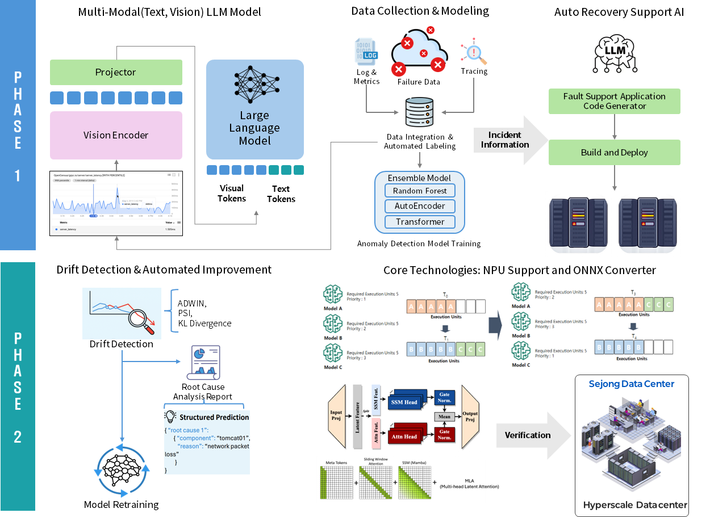

# 클라우드 장애극복을 위한 AI 어시스턴트 기반 운영·관리 자동화 기술개발

**AI Assistant-based Automation Technologies for Operations and Management in Cloud Failure Recovery**

과학기술정보통신부 · 정보통신기획평가원(IITP) SW컴퓨팅산업원천기술개발사업 · RS-2025-25441560 · 2025.07 – 2028.12

---

클라우드가 마이크로서비스 중심의 클라우드 네이티브로 바뀌면서 장애의 원인을 찾고 대응하는 일은 점점 사람의 경험에 기대기 어려워지고 있습니다.
이 과제는 **AIOps와 대규모 언어 모델(LLM)을 결합**해 메트릭·로그·트레이스 같은 관측 데이터로 장애를 인식하고 근본 원인을 분석하며,
그 판단 과정을 운영자에게 설명하고 복구 워크플로우까지 이어 주는 **AI 어시스턴트**를 개발합니다.
폐쇄망에서도 쓸 수 있도록 경량 모델과 NPU 추론을 함께 다루며, 연구 결과는 이 조직의 저장소로 공개합니다.

## 핵심 기술

| 기술 | 내용 |
|---|---|
| 관측 데이터 기반 장애 인식·원인 분석 지능형 추론 | 메트릭·로그·트레이스를 LLM이 이해하도록 정렬·압축하고, 이종 관측 데이터와 과거 인시던트를 함께 고려해 근본 원인을 추론 |
| 멀티모달 AI 어시스턴트 | 차트·대시보드·문서·음성까지 이해하는 경량 멀티모달 LLM과 운영 지식 보강 RAG |
| AI 어시스턴트 응용 개발 플랫폼 | 워크플로우 자동화 도구(n8n·MCP)와 연계한 장애 대응 서비스, 생성형 코드 AI 연계 운용 컴포넌트 |
| 실환경 NPU 활용 | NPU 환경 AIOps 모델 패키징, ONNX 변환, 멀티 모델 병렬 추론 엔진 |
| 이상탐지·드리프트 대응 모델 | 시계열·로그 이상탐지, 모델 드리프트 탐지와 온라인 재학습 |
| 장애 대응 경량 모델 | 거대 언어 모델의 지식을 증류한 경량 모델, 하드웨어 특성에 맞춘 자동 양자화 |

## 컨소시엄

| 기관 | 역할 |
|---|---|
| **오케스트로** (주관) | 과제 총괄, 관측 데이터 기반 장애 인식·원인 분석 지능형 추론, 멀티모달 AI 어시스턴트, 공개 SW 활동 |
| **한국전자기술연구원** (KETI) | 장애 대응 전주기 워크플로우 자동화와 AI 어시스턴트 응용 개발 플랫폼, NPU 환경 AIOps 모델 패키징·추론 |
| **한양대학교** | 클라우드 장애 데이터 수집과 이상탐지·드리프트 대응 모델, 장애 대응 경량 모델, ISA별 최적 양자화 |

탐지 알고리즘 → 추론 파이프라인 → LLM 응답 처리 → 자동화된 대응 실행으로 이어지는 운영 기술 흐름을 세 기관이 나누어 맡습니다.

## 단계별 추진 내용

| 단계 | 기간 | 주요 내용 |
|---|---|---|
| 1단계 · 1차년도 | 2025.07 – 2025.12 | 시계열 모달리티 정렬, 로그 파싱·압축, 관측 데이터 유형 특수 토큰 SFT, Multimodal RAG / 장애 대응 워크플로우 요구 분석, MCP 활용 설계 / 장애 주입 데이터 수집, 이상탐지 모델 |
| 1단계 · 2차년도 | 2026.01 – 2026.12 | 유사 인시던트 검색·재순위화 리트리버, 트레이스 지식 그래프, Vision 기반 멀티모달 LLM, 이종 관측 데이터 융합 근본원인 예측 / 워크플로우 연계 장애 대응 서비스, NPU 활용 기술 분석 / 드리프트 탐지·온라인 재학습, ISA별 양자화 벤치마크 |
| 2단계 · 3차년도 | 2027.01 – 2027.12 | 멀티모달 백본 경량화와 모달 전문화 학습 / 응용 개발 플랫폼 통합, 실환경 NPU 추론 엔진·ONNX 변환기 / Mixed-Precision 매핑과 양자화 정밀도 자동 추천 |
| 2단계 · 4차년도 | 2028.01 – 2028.12 | 실시간 서비스용 MLLM 경량화, 모듈 단위 파라미터 로딩, 디지털트윈 데이터센터 관제 연계 / 플랫폼·NPU 활용 고도화 / Auto-Quant 학습·재배포 파이프라인 실증 |

## 성능 목표 (최종)

| 지표 | 목표 |
|---|---|
| AI 모델 입력에서 지원하는 관측 가능성 데이터 유형 수 | 4종 이상 |
| 경량(3B 이하) 멀티모달 LLM의 모달리티별 벤치마크 정확도 (MMLU · MMMU · MMAU) | 55% · 55% · 70% 동시 달성 |
| 워크플로우 자동화 도구 기반 Local sLLM 지원 | 지원 |
| NPU 기반 장애 대응 요청 처리 응답 지연 | 200 ms 이하 |
| 경량 모델의 OpenRCA 벤치마크 예측 성능 | 10% · 30% 이상 |
| 양자화 모델의 성능 유지와 자원 효율 (정확도 유지율 · 지연 감소율 · 전력 감소율) | 95% · 40% · 30% |
| 클라우드 장애 데이터셋 생성·공개 | 1건 |

## 저장소

### 공개 데이터셋

| 저장소 | 내용 | 기관 |
|---|---|---|
| [cloud-incident-taxonomy](https://github.com/OKESTRO-AICloudRecovery/cloud-incident-taxonomy) | 오케스트로 SR로 인입된 고객사 클라우드 장애 231건을 원인 기준 3단 계층(14 / 73 / 213)으로 분류한 데이터셋 (비식별 처리, CC BY 4.0) | 오케스트로 |

### 2차년도 (2026)

| 저장소 | 내용 | 기관 |
|---|---|---|
| [MSO-RCA](https://github.com/OKESTRO-AICloudRecovery/MSO-RCA) | 메트릭·로그·트레이스를 시간 구간에 정렬하고 융합해 근본 원인 서비스 순위를 매기는 분석기 (RCAEval RE2) | 오케스트로 |
| [trace-knowledge-graph](https://github.com/OKESTRO-AICloudRecovery/trace-knowledge-graph) | 분산 트레이스 기반 서비스 의존 지식 그래프: 토폴로지 변경, SPOF, 장애 전파 경로, LLM 입력 인코딩 | 오케스트로 |
| [incident-retriever](https://github.com/OKESTRO-AICloudRecovery/incident-retriever) | 이종 관측 데이터 기반 유사 인시던트 희소·밀집 하이브리드 검색과 RAG 컨텍스트 구성 | 오케스트로 |
| [rca-reasoning](https://github.com/OKESTRO-AICloudRecovery/rca-reasoning) | LLM 근본원인 추론용 구조화 CoT 프롬프트와 다중 가설 검증 | 오케스트로 |
| [lightweight-mllm](https://github.com/OKESTRO-AICloudRecovery/lightweight-mllm) | 운영 시각 데이터 VQA 데이터셋 구축과 경량 멀티모달 LLM 벤치마크 (MMLU · MMMU · MMAU) | 오케스트로 |

### 1차년도 (2025)

| 저장소 | 내용 | 기관 |
|---|---|---|
| [ts-align](https://github.com/OKESTRO-AICloudRecovery/ts-align) | 시스템 메트릭 시계열을 LLM 임베딩 공간에 정렬하는 학습 코드 | 오케스트로 |
| [universal-rag](https://github.com/OKESTRO-AICloudRecovery/universal-rag) | 장애 유형별 공개 Q&A 지식 수집과 메트릭 분석·근본원인 진단 프롬프트 | 오케스트로 |
| [Document_Parser](https://github.com/OKESTRO-AICloudRecovery/Document_Parser) | 문서·테이블 이해 VLM 미세조정과 OmniDocBench 추론 | 오케스트로 |
| [Speech-Language-Model](https://github.com/OKESTRO-AICloudRecovery/Speech-Language-Model) | 음성 인코더와 LLM을 결합한 음성-언어 모델 학습·평가 | 오케스트로 |
| [Structural_Chunking](https://github.com/OKESTRO-AICloudRecovery/Structural_Chunking) | RAG용 문서 청킹 방법(의미·통계·구조) 비교 벤치마크 (BEIR) | 오케스트로 |
| [DRWorkflowEngine](https://github.com/OKESTRO-AICloudRecovery/DRWorkflowEngine) | Airflow·Argo 기반 클라우드 네이티브 장애 복구 워크플로우 엔진, n8n·MCP 연동 | KETI |
| [n8n-GenAIOps](https://github.com/OKESTRO-AICloudRecovery/n8n-GenAIOps) | n8n 워크플로우 자동화 도구 기반 생성형 AI 운영 | KETI |
| [Time-Series_Drift_Detection](https://github.com/OKESTRO-AICloudRecovery/Time-Series_Drift_Detection) | 자기지도 시계열 표현 학습 기반 드리프트 탐지 | 한양대 |
| [Semantic_Drift_Detection](https://github.com/OKESTRO-AICloudRecovery/Semantic_Drift_Detection) | 비전·언어 파운데이션 모델 기반 학습 없는 이상 탐지 | 한양대 |
| [OpenRCA](https://github.com/OKESTRO-AICloudRecovery/OpenRCA) | LLM 근본원인 분석 벤치마크 (평가용 fork) | — |

## 참여하기

이슈와 풀 리퀘스트를 환영합니다. 저장소마다 테스트와 사용 예가 README에 있으며, 2차년도 저장소는 Apache-2.0, 1차년도 저장소는 MIT, 데이터셋은 CC BY 4.0 라이선스입니다.

## 사사

이 연구는 2025년도 정부(과학기술정보통신부)의 재원으로 정보통신기획평가원의 지원을 받아 수행되었습니다.
(RS-2025-25441560, 클라우드 장애극복을 위한 AI 어시스턴트 기반 운영·관리 자동화 기술개발)

---

**English.** This organization hosts the open-source results of a Korean national R&D project (IITP, 2025.07–2028.12) led by OKESTRO with KETI and Hanyang University. The project combines AIOps with large language models to build an AI assistant that recognizes cloud failures from metrics, logs and traces, explains the root cause, and drives recovery workflows — with lightweight multimodal models and NPU inference for closed environments.
